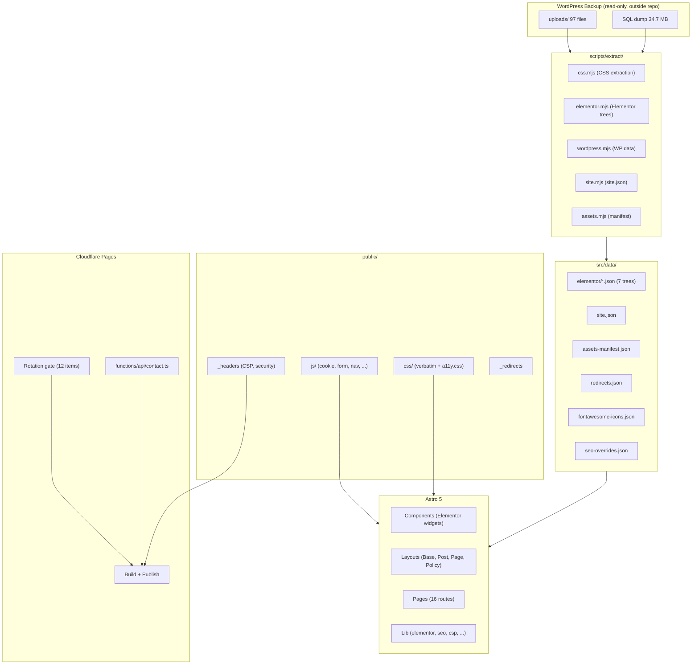
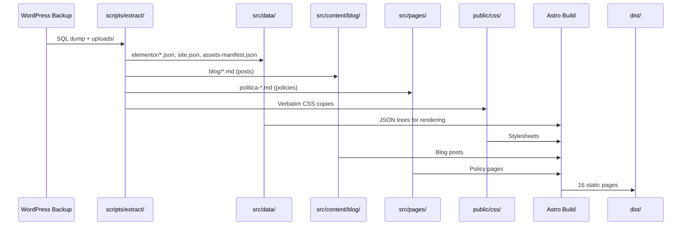
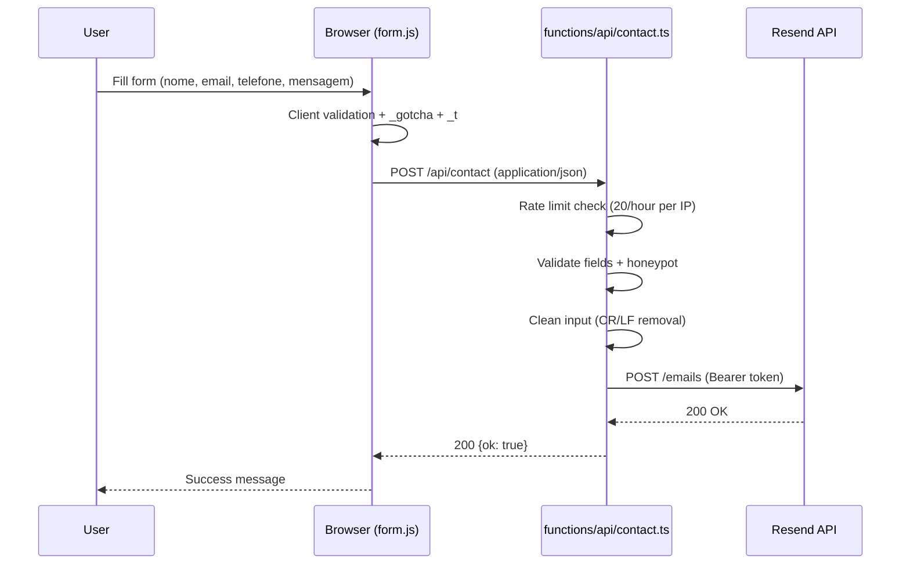

# Codebase Map — Galastri Advocacia

> Auto-generated by Cartographer. Last mapped: 2026-10-20T21:10:21Z

## System Overview

This is a **migrated law-firm website** (`galastriadvocacia.com.br`) from **WordPress 6.9.4 + Elementor 3.35.7 (kava theme)** to a **static Astro 5** site deployed on **Cloudflare Pages**. The migration strategy is "DOM replay": Elementor's CSS is copied verbatim and the HTML is reproduced so the original CSS applies unchanged. The repo is public (`devCarlosHenSil/galastriadvocacia`).

**Key state:** Implementation is complete and validated, and the site is **live** at `https://www.galastriadvocacia.com.br` (Cloudflare Pages). The 12-item rotation gate is still **red** (the client must rotate the backup credentials) — the publication happens by the owner's explicit decision (D88, `ROTATION_GATE=skip`).



## Directory Structure

```
galastriadvocacia/
├── .github/workflows/          # CI verification (deploy.yml)
├── docs/                       # Project documentation
│   ├── _reference/             # Reference CSS, extraction reports
│   ├── CONTENT-EDITING.md      # Content editing guide
│   ├── DEPLOY.md               # Deployment runbook
│   ├── MIGRATION.md            # Migration documentation
│   ├── PARITY.md               # Visual parity measurements
│   ├── PLAN.md                 # Project plan
│   ├── PROJECT-STATE.md        # Current state tracker
│   ├── README.md               # Docs index
│   ├── rotation-gate.md        # 12-item rotation checklist
│   ├── runbook-pages.md        # Cloudflare Pages operations
│   ├── security-decisions.md   # Security decisions log
│   ├── SPEC-DATA.md            # Data specification
│   ├── SPEC-SECURITY.md        # Security specification
│   └── SPEC-UI.md              # UI specification
├── functions/                  # Cloudflare Functions
│   └── api/contact.ts          # Contact form handler
├── public/                     # Static assets
│   ├── css/                    # CSS files (verbatim + overrides)
│   ├── fonts/                  # Self-hosted fonts
│   ├── js/                     # Client-side scripts
│   ├── wp-content/             # WordPress uploads (verbatim)
│   ├── _headers                # Security + CSP headers
│   ├── _redirects              # Redirect rules
│   └── robots.txt              # Robots directive
├── scripts/                    # Build and check scripts
│   ├── extract/                # Content extraction pipeline
│   │   ├── index.mjs           # Main entry point
│   │   └── lib/                # Extraction modules
│   │       ├── allowlist.mjs   # Write allowlist
│   │       ├── assets.mjs      # Asset manifest
│   │       ├── authored.mjs    # Authored content overlay
│   │       ├── css.mjs         # CSS extraction
│   │       ├── elementor.mjs   # Elementor tree extraction
│   │       ├── fonts.mjs       # Font extraction
│   │       ├── gutenberg.mjs   # Gutenberg blocks
│   │       ├── overlay.mjs     # Content overlay
│   │       ├── php.mjs         # PHP parsing
│   │       ├── repairs.mjs     # Content repairs
│   │       ├── sanitize.mjs    # Content sanitization
│   │       ├── site.mjs        # site.json generation
│   │       ├── sql.mjs         # SQL parsing
│   │       ├── urls.mjs        # URL extraction
│   │       └── wordpress.mjs   # WordPress data
│   ├── lib/                    # Shared scripts
│   │   ├── backup-values.mjs   # Backup value extraction
│   │   └── forbidden.mjs       # Secret patterns + digests
│   ├── check-*.mjs             # Check scripts (parity, links, contrast, dist, function)
│   ├── guard-secrets.mjs       # Secret/PII scanning guard
│   ├── guard-self-test.mjs     # Guard self-test
│   ├── build-pages.mjs         # Cloudflare Pages build command
│   ├── css.mjs                 # CSS build entry
│   ├── generate-pii-digests.mjs # PII digest generator
│   ├── update-parity-fixtures.mjs # Fixture regenerator
│   ├── verify-csp.mjs          # CSP verification
│   ├── verify-workflow.mjs     # CI workflow verification
│   └── visual-diff.mjs         # Pixel diff (optional)
├── src/                        # Astro source
│   ├── components/             # Astro components
│   │   ├── elementor/          # Elementor renderer system
│   │   │   ├── ElementorRenderer.astro   # Main renderer
│   │   │   ├── ElementorWidget.astro     # Widget dispatcher
│   │   │   └── widgets/              # Widget components
│   │   │       ├── AuthorBox.astro
│   │   │       ├── Button.astro
│   │   │       ├── Copyright.astro
│   │   │       ├── Divider.astro
│   │   │       ├── ElementskitTestimonial.astro
│   │   │       ├── Form.astro
│   │   │       ├── GoogleMaps.astro
│   │   │       ├── Heading.astro
│   │   │       ├── Html.astro
│   │   │       ├── IconBox.astro
│   │   │       ├── IconList.astro
│   │   │       ├── Image.astro
│   │   │       ├── ImageBox.astro
│   │   │       ├── NavMenu.astro
│   │   │       ├── PostContent.astro
│   │   │       ├── PostFeaturedImage.astro
│   │   │       ├── PostInfo.astro
│   │   │       ├── PostTitle.astro
│   │   │       ├── RelatedPosts.astro
│   │   │       ├── SocialIcons.astro
│   │   │       ├── TextEditor.astro
│   │   │       ├── ThemeSiteLogo.astro
│   │   │       ├── UpkAlexGrid.astro
│   │   │       ├── UpkAmoxGrid.astro
│   │   │       └── UpkPostCategory.astro
│   │   ├── CookieConsent.astro # Cookie consent banner
│   │   ├── Footer.astro        # Footer component
│   │   └── Header.astro        # Header component
│   ├── content/                # Content collections
│   │   └── blog/               # Blog posts
│   │       ├── 5aspectos-cruciais-direito-de-familia.md
│   │       ├── bpc-loas-bloqueado.md
│   │       ├── guarda-compartilhada.md
│   │       ├── jovem-aprendiz.md
│   │       ├── pis-pasep-2025.md
│   │       └── salario-maternidade.md
│   ├── data/                   # Extracted data
│   │   ├── elementor/          # Elementor JSON trees
│   │   │   ├── blog-archive-516.json
│   │   │   ├── error-404-790.json
│   │   │   ├── footer-48.json
│   │   │   ├── header-49.json
│   │   │   ├── home-30.json
│   │   │   ├── links-843.json
│   │   │   └── post-single-525.json
│   │   ├── assets-manifest.json  # Asset manifest
│   │   ├── fontawesome-icons.json # Font Awesome icons
│   │   ├── redirects.json        # Redirect register
│   │   ├── seo-overrides.json    # SEO overrides
│   │   └── site.json             # Site configuration
│   ├── layouts/                # Layout components
│   │   ├── BaseLayout.astro    # Base layout
│   │   ├── PageLayout.astro    # Page layout
│   │   ├── PolicyLayout.astro  # Policy page layout
│   │   └── PostLayout.astro    # Blog post layout
│   ├── lib/                    # Library modules
│   │   ├── assets.ts           # Asset handling
│   │   ├── csp.ts              # CSP configuration
│   │   ├── elementor.ts        # Elementor renderer logic
│   │   ├── fontawesome.ts      # Font Awesome handling
│   │   ├── image.ts            # Image handling
│   │   ├── nav.ts              # Navigation
│   │   ├── post-context.ts     # Post context
│   │   ├── seo.ts              # SEO helpers
│   │   ├── stylesheets.ts      # Stylesheet management
│   │   └── svg.ts              # SVG handling
│   ├── pages/                  # Page routes
│   │   ├── [slug].astro        # Dynamic post page
│   │   ├── 404.astro           # 404 page
│   │   ├── blog.astro          # Blog archive
│   │   ├── category/[slug].astro # Category archive
│   │   ├── index.astro         # Home page
│   │   ├── links.astro         # Links page
│   │   ├── politica-de-cookies-galastri-advocacia.md
│   │   ├── politica-de-privacidade.md
│   │   └── politica-de-uso-de-inteligencia-artificial-galastri-advocacia.md
│   └── content.config.ts       # Content collection config
├── tests/                      # Test fixtures
│   └── fixtures/               # Golden HTML fixtures
│       ├── elementor-cache-30.html (skipped - 56k)
│       ├── elementor-cache-48.html (footer)
│       ├── elementor-cache-49.html (header)
│       ├── nav-menu.html (nav menu)
│       └── upk-grid.html (blog grid)
├── AGENTS.md                   # Working agreement
├── astro.config.mjs            # Astro configuration
├── package.json                # Dependencies and scripts
├── tsconfig.json               # TypeScript config
└── ...                         # Other config files
```

## Module Guide

### Elementor Rendering System

**Purpose:** Replays Elementor's DOM using Astro components, with verbatim CSS.

**Entry point:** `src/components/elementor/ElementorRenderer.astro`

**Key files:**
| File | Purpose | Tokens |
|------|---------|--------|
| `ElementorRenderer.astro` | Main renderer that walks Elementor JSON trees | 774 |
| `ElementorWidget.astro` | Widget dispatcher that maps widgetType to component | 934 |
| `src/lib/elementor.ts` | Core Elementor rendering logic and helpers | 2358 |

**Data flow:**
1. `ElementorRenderer` receives an Elementor JSON tree from `src/data/elementor/`
2. For each node, it delegates to `ElementorWidget` which dispatches to the specific widget component
3. Each widget component renders the HTML structure matching Elementor's output
4. CSS from `public/css/` applies to the rendered DOM (verbatim copies of Elementor CSS)
5. `a11y.css` provides accessibility corrections as the last cascade layer

**Dependencies:** `src/data/elementor/*.json`, `public/css/*.css`, `src/lib/site.ts`, `src/lib/image.ts`

**Gotchas:**
- The `root` of Elementor JSONs is an **ARRAY** of top-level elements, not an object
- Widget components must reproduce Elementor's HTML structure **exactly** for CSS to apply
- `elementor-invisible` class hides animated elements — `elementor-animations.js` removes this on scroll
- The CSS is class-based — removing/renaming any class breaks layout silently

### Extraction Pipeline

**Purpose:** Generates all content data from the WordPress SQL dump and uploads directory.

**Entry point:** `scripts/extract/index.mjs`

**Key files:**
| File | Purpose | Tokens |
|------|---------|--------|
| `index.mjs` | Main entry point | 11865 |
| `lib/css.mjs` | CSS extraction | 11439 |
| `lib/authored.mjs` | Authored content overlay | 8944 |
| `lib/elementor.mjs` | Elementor tree extraction | 3507 |
| `lib/site.mjs` | site.json generation | 2994 |
| `lib/assets.mjs` | Asset manifest | 2168 |
| `lib/wordpress.mjs` | WordPress data | 2185 |
| `lib/urls.mjs` | URL extraction | 1568 |
| `lib/gutenberg.mjs` | Gutenberg blocks | 1591 |
| `lib/sanitize.mjs` | Content sanitization | 1462 |
| `lib/overlay.mjs` | Content overlay | 1416 |
| `lib/fonts.mjs` | Font extraction | 1697 |
| `lib/sql.mjs` | SQL parsing | 869 |
| `lib/repairs.mjs` | Content repairs | 894 |
| `lib/php.mjs` | PHP parsing | 693 |
| `lib/allowlist.mjs` | Write allowlist | 493 |
| `check.mjs` | Idempotency check | 1342 |

**Pipeline flow:**
```
SQL dump + uploads/ (from <BACKUP>, outside repo)
    │
    ├─► elementor.mjs  →  src/data/elementor/*.json  (7 trees)
    ├─► css.mjs        →  public/css/*.css           (verbatim copies)
    ├─► wordpress.mjs  →  wp_options, wp_postmeta    (filtered)
    ├─► site.mjs       →  src/data/site.json         (nav, SEO, form, etc.)
    ├─► assets.mjs     →  src/data/assets-manifest.json
    ├─► fonts.mjs      →  public/fonts/, public/css/fonts.css
    ├─► gutenberg.mjs  →  src/content/blog/*.md      (posts)
    └─► authored.mjs   →  src/pages/*.md             (policy pages)
```

**Dependencies:** WordPress SQL dump, WordPress uploads directory (both outside repo)

**Gotchas:**
- Extraction is **byte-idempotent** — no timestamps, absolute paths, or random data
- The allowlist restricts writes to 8 prefixes + 1 exact file
- Content corrections go in `repairs.mjs`, `authored.mjs`, or `overlay.mjs` — never in generated files
- `npm run extract:check` validates idempotency
- If dump or uploads are inside the project, extraction **aborts**

### Security System

**Purpose:** Three-layer protection against secret/PII leaks and unauthorized publication.

**Key files:**
| File | Purpose | Tokens |
|------|---------|--------|
| `guard-secrets.mjs` | Secret/PII scanning guard | 3148 |
| `lib/forbidden.mjs` | Secret patterns + digests | 8786 |
| `guard-self-test.mjs` | Guard self-test | 2699 |
| `generate-pii-digests.mjs` | PII digest generator | 2253 |
| `check-rotation-gate.mjs` | Rotation gate checker | 795 |
| `check-audit.mjs` | Dependency audit | 973 |
| `verify-csp.mjs` | CSP verification | 1591 |
| `verify-workflow.mjs` | CI workflow verification | 3373 |

**Three layers:**
1. **Guard** (`npm run guard`): Scans `src/`, `public/`, `scripts/`, `tests/`, `docs/`, `.github/` for secrets and PII
2. **Rotation gate** (`npm run gate:rotation`): Blocks publication until 12 credentials are rotated — currently **bypassed** by the owner's decision (D88, `ROTATION_GATE=skip`), so the publication is happening
3. **CSP verification** (`npm run verify-csp`): Ensures 3 forms of CSP are identical

**Dependencies:** `docs/rotation-gate.md`, `src/lib/csp.ts`, `public/_headers`, `docs/DEPLOY.md`, `scripts/private/pii-digests.json`

**Gotchas:**
- Two-tier digest system: high-entropy (versioned) and low-entropy (git-ignored)
- The guard self-test **skips** in CI (no backup available)
- The rotation gate is still **RED** (all 12 pending) — the publication happens by the owner's explicit decision (D88: `ROTATION_GATE=skip`)
- `ROTATION_GATE=skip` (D88) is an explicit owner decision to publish before rotation

### Contact Form System

**Purpose:** End-to-end contact form with LGPD consent, spam protection, and email delivery.

**Key files:**
| File | Purpose | Tokens |
|------|---------|--------|
| `functions/api/contact.ts` | Cloudflare Function handler | 4331 |
| `public/js/form.js` | Client-side form handler | 1728 |
| `public/js/phone-mask.js` | Phone number mask | 332 |
| `src/lib/csp.ts` | CSP configuration | 820 |
| `docs/DEPLOY.md` §4 | Deployment runbook | 6700 |

**Flow:**
```
Browser (form.js)
  ├─ Client validation + honeypot + elapsed time
  └─ POST /api/contact (application/json)
       │
       ▼
Contact Function
  ├─ Rate limit (20/hour per IP, in-memory)
  ├─ Validate all fields
  ├─ Honeypot check (silent 200 on spam)
  └─ POST to Resend API → email to contato@...
```

**Dependencies:** Resend API key (Cloudflare secret), `site.json` form configuration

**Gotchas:**
- Rate limit is **not durable** (in-memory, per-isolate)
- The `_t` field is elapsed ms (not a timestamp) — validated 3s-24h
- Function rejects `form-urlencoded` (requires JSON) — the HTML fallback is informational only
- `RESEND_API_KEY` must be a Cloudflare Pages **Secret**

### CSS System

**Purpose:** Verbatim Elementor CSS with accessibility overlay.

**Key files:**
| File | Purpose | Tokens | Notes |
|------|---------|--------|-------|
| `a11y.css` | Accessibility corrections | 7510 | **Hand-written** (only editable CSS) |
| `tokens.css` | Design tokens | 1325 | **Hand-written** |
| `elementor-home.css` | Home page styles | 26364 | Verbatim copy of post-30.css |
| `elementor-footer.css` | Footer styles | 7033 | Verbatim copy of post-48.css |
| `elementor-header.css` | Header styles | 3017 | Verbatim copy of post-49.css |
| `elementor-core.css` | Elementor base CSS | 14784 | Verbatim copy of custom-frontend.min.css |
| `widgets.css` | Widget CSS | 25625 | Verbatim concatenation |
| `theme.css` | Kava theme CSS | 29940 | Verbatim copy |
| `theme-dynamic.css` | Theme dynamic CSS | 9285 | Verbatim copy |
| `upk.css` | UPK plugin CSS | 20997 | Verbatim copy |
| `fontsize5.css` | WebKit fixes + Pro widgets | 21255 | Verbatim copy |
| `fonts.css` | Self-hosted fonts | 15018 | Generated by fonts.mjs |
| `swiper.css` | Swiper library | 4836 | Verbatim copy |
| `elementor-kit.css` | Kit variables | 1998 | Verbatim copy of post-6.css |

**Cascade order:** theme → theme-dynamic → elementor-core → widgets → upk → fontsize5 → elementor-kit → elementor-header → elementor-home → elementor-footer → **tokens → a11y** (last two are overrides)

**Gotchas:**
- I1 invariant: Elementor CSS is **byte-identical** to WordPress backup
- Only `a11y.css` and `tokens.css` can be edited
- `a11y.css` uses `!important` where Elementor CSS has higher specificity
- 24 contrast fixes (A1-A24) in `a11y.css` with 25 total cases
- `elementskit.css` and `elementor-widgets.css` are too large for this map (they are published verbatim like the rest)

### CI/CD Pipeline

**Purpose:** Verification-only pipeline. Cloudflare Pages handles actual publication.

**Key files:**
| File | Purpose | Tokens |
|------|---------|--------|
| `.github/workflows/deploy.yml` | CI verification | 1995 |
| `scripts/build-pages.mjs` | Cloudflare build command | 1574 |

**Workflow:**
```
git push → GitHub Actions (verify only, no publish)
              │
              ├─ verify-workflow
              ├─ npm ci
              ├─ npm audit → check-audit
              ├─ guard-secrets
              ├─ astro check (type validation)
              ├─ check-function (static)
              ├─ npm run build (SITE_BASE='/')
              ├─ verify-csp
              ├─ check-parity
              ├─ check-links
              ├─ check-contrast
              ├─ check-redirects
              ├─ guard-self-test (skip without backup)
              └─ check-dist

Cloudflare Pages integration → actual build + publish
  └─ build command: node scripts/build-pages.mjs
     ├─ guard-secrets
     ├─ astro build
     └─ check-rotation-gate (blocks production)
```

**Gotchas:**
- GitHub Actions has **zero publish permissions** — no `pages: write`, no `id-token: write`
- Only 2 SHA-pinned actions (checkout, setup-node)
- Build uses Node 20, Functions use Node 22
- Rotation gate lives in Cloudflare build, not in CI

### Documentation

**Purpose:** Comprehensive project documentation following Diataxis.

**Key files:**
| File | Purpose | Tokens |
|------|---------|--------|
| `SPEC-DATA.md` | Data specification | 34398 |
| `SPEC-UI.md` | UI specification | 30988 |
| `SPEC-SECURITY.md` | Security specification | 30972 |
| `PROJECT-STATE.md` | Current state tracker | 29088 |
| `PLAN.md` | Project plan | 14657 |
| `security-decisions.md` | Security decisions log | 8527 |
| `DEPLOY.md` | Deployment runbook | 6700 |
| `CONTENT-EDITING.md` | Content editing guide | 4063 |
| `MIGRATION.md` | Migration documentation | 4642 |
| `PARITY.md` | Visual parity measurements | 2672 |
| `README.md` | Docs index | 2118 |
| `runbook-pages.md` | Cloudflare Pages operations | 1529 |
| `rotation-gate.md` | 12-item rotation checklist | 1349 |

**Reading order:**
- **For developers:** AGENTS.md → SPEC-DATA.md → SPEC-SECURITY.md → SPEC-UI.md → PLAN.md → PARITY.md → runbook-pages.md → security-decisions.md → extract-report.json
- **For content editors:** CONTENT-EDITING.md (the only file they need)
- **For reviewers:** PROJECT-STATE.md → PLAN.md → SPECs → MIGRATION.md → PARITY.md → rotation-gate.md → security-decisions.md → AGENTS.md

**Gotchas:**
- Code is the primary source of truth — if code and docs diverge, **code wins**
- `<LOCAL>` and `<BACKUP>` are placeholders for actual paths
- Secrets use `<REDACTED:what it is>` pattern with origin and form

## Data Flow

### Content Flow: WordPress → Astro



### Contact Form Flow



## Conventions

### Naming
| Item | Pattern | Example |
|------|---------|---------|
| Routes | lowercase, trailing slash | `/guarda-compartilhada/` |
| Post slug | WordPress `post_name` verbatim | `bpc-loas-bloqueado` |
| Post file | `<slug>.md` | `src/content/blog/guarda-compartilhada.md` |
| Component | `PascalCase.astro` | `src/components/elementor/widgets/NavMenu.astro` |
| Module | `kebab-case.ts` | `src/lib/post-context.ts` |
| Script | `verb-noun.mjs` | `scripts/check-parity.mjs` |
| Elementor ID | Original ID, never renamed | `af9b6b1` |
| cssId (anchor) | `_element_id` normalized | `home`, `sobre`, `areasdeatuacao`, `servicos`, `quemsou`, `contato` |
| Decision ID | `D<n>` (state), `SEC-<n>` (security), `T<n>.<n>` (plan) | `D64` |
| Commit | `type: description` | `content: novo post sobre PIS/Pasep 2025` |

### Code Style
- **TypeScript strict mode** — all code must be fully typed
- **pt-BR prose** for documentation; English for commands, paths, identifiers
- **Zero runtime dependencies** beyond Astro (by design)
- **Node 20** for build, **Node 22** for Functions testing
- **Idempotent output** — no timestamps, absolute paths, or random data in generated files

## Gotchas

1. **Never `git init` in `<BACKUP>`** — the new repo is a subfolder of the backup; doing so publishes the SQL dump and `wp-config.php` (SEC-01, SEC-23)
2. **CSS is byte-identical to WordPress backup** — removing/renaming any class breaks layout silently (I1)
3. **`a11y.css` is the last `<link>` in the cascade** — it's the only editable CSS file
4. **Extraction is the single source of truth for content** — corrections go in `repairs.mjs`, `authored.mjs`, or `overlay.mjs` (I2)
5. **The guard and rotation gate are hard gates** — they block build/publication, not development (I3)
6. **The repo is public** — no absolute paths, secrets, or PII of third parties (I4)
7. **Timezone trap:** `pubDate` without quotes → YAML returns `Date` (UTC midnight) → renders one day earlier in São Paulo. All date renders MUST use `timeZone: 'UTC'`
8. **`#quemsou` without hyphen** — the real `_element_id`; "fixing" it breaks the `scroll-offset`
9. **`srcset`/`sizes` must be removed together** — leaving either points to unpublished thumbnails
10. **`-scaled` suffix is NOT a thumbnail** — WordPress numeric suffixes (`...-e1734733392829.png`) also not thumbnails
11. **The `_elementor_element_cache` is the parity oracle** — HTML already rendered by Elementor, with base64 placeholders for dynamic widgets
12. **Font Awesome 5 is required** — DOM uses `fab`/`fas`/`far` (FA5), but Elementor's `font-awesome.min.css` is FA 4.7.0
13. **Cloudflare Pages recreates the `www` CNAME automatically** — it must be **verified** after every deploy, and it must **stay**: the `www` is the canonical address (D91) and the apex 301s to it
14. **SPF has exactly one `v=spf1` record per domain** — two TXT records with SPF close the domain with `permerror`
15. **The rotation gate is currently RED** — 12 items pending; it is **bypassed** by the owner's decision (D88, `ROTATION_GATE=skip`), so the publication **is** happening with the backup credentials still valid
16. **`Referrer-Policy: no-referrer` would break the form** (and the analytics) — use `strict-origin-when-cross-origin`
17. **`root` of Elementor JSONs is an ARRAY** of top-level elements (10 in post 30), not an object
18. **`data-e-type` only exists in Elementor 3.29+** — appears in new HTML, not in Wayback snapshot
19. **The `elementskit.css` and `elementor-widgets.css` are too large for this map** — they are published verbatim, like the rest of the Elementor CSS
20. **Rate limit in contact Function is not durable** — in-memory, per-isolate (20/hour per IP); the durable fix is a WAF rate limit at the edge

## Navigation Guide

**To add a new blog post:**
1. Create `src/content/blog/<slug>.md` with proper frontmatter (see `CONTENT-EDITING.md`)
2. Add SEO entry to `src/data/seo-overrides.json`
3. Run `npm run dev` to verify
4. Run `npm run build` to check guard passes

**To modify Elementor content:**
1. Fix in the extraction source: `scripts/extract/lib/repairs.mjs`, `authored.mjs`, or `overlay.mjs`
2. Run `npm run extract` to regenerate
3. Run `npm run extract:check` to verify idempotency

**To fix a CSS issue:**
1. Add override to `public/css/a11y.css` (the last cascade layer)
2. Use `!important` only if Elementor CSS has higher specificity
3. Run `npm run check-contrast` to verify contrast

**To modify the contact form:**
1. Edit `functions/api/contact.ts` for server-side logic
2. Edit `public/js/form.js` for client-side validation
3. Run `npm run check:function` to verify

**To modify the CSP:**
1. Edit `src/lib/csp.ts` (source of truth)
2. Update `public/_headers` to match
3. Run `npm run verify-csp` to verify all 3 forms match

**To update the rotation gate:**
1. Mark `☑` + date + responsible + sha256 of screenshot in `docs/rotation-gate.md`
2. Run `npm run gate:rotation` to verify (exits 0 when all 12 are checked)

**To verify parity after DOM changes:**
1. Run `npm run check-parity` (structural comparison)
2. Run `npm run check-links` (link resolution)
3. Run `npm run check-contrast` (color contrast)
4. Run `npm run check-dist` (artifact safety)

---

*Generated by Cartographer — https://github.com/kingbootoshi/cartographer*